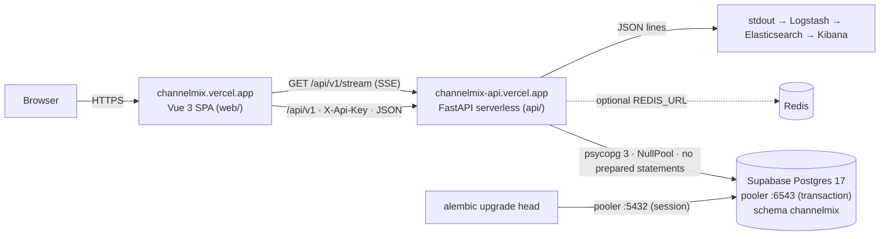

# ChannelMix — Cross-channel Ad Spend Dashboard & Budget Optimizer

| | |
|---|---|
| **Web (live)** | https://channelmix.vercel.app |
| **API (live)** | https://channelmix-api.vercel.app — health: `/health`, OpenAPI: `/docs`, spec: `/api/v1/openapi.json` |
| **Contract** | [`api/CONTRACT.md`](api/CONTRACT.md) (v1) |

ChannelMix unifies spend and performance from **Google Ads, Meta Ads, Amazon Ads (and anything else via CSV / REST)**
into one data model and one dashboard, computes channel-level KPIs (ROAS, CPA, CTR, CPC) and recommends how to
**reallocate daily budget toward the channel with the highest *marginal* ROAS** — with an explanation for every
recommendation.

It is a real multi-tenant product, not a demo: open the URL, create a workspace (name + email, no password), drop in
your Google Ads / Meta Ads Manager export and watch the dashboard update live. There is no bundled mock data and no
"demo mode" — if the API is unreachable the UI says so and offers a Retry.

| Layer | Stack |
|---|---|
| API | Python 3.12 · FastAPI · SQLAlchemy 2 · PostgreSQL 17 on Supabase (psycopg 3, schema `channelmix`) · Alembic · SQLite for tests · Redis optional (in-memory LRU fallback) |
| Web | Vue 3 · Vite · TypeScript · Pinia · ECharts · Vitest · General Sans (Fontshare) · dark theme |
| Quality | pytest + **pytest-bdd (Gherkin)** · ruff · Vitest · GitHub Actions (Postgres + Redis service containers, Docker build) |
| Hosting | Vercel: `channelmix` (static SPA, root `web/`) + `channelmix-api` (Python serverless, root `api/`, region `bom1`) |
| Ops (local) | Docker Compose (api, web, postgres, redis, elasticsearch, logstash, kibana) · structured JSON request logs → ELK |

---

## Architecture



**Request flow.** Every request except `POST /workspaces` and `/health` carries `X-Api-Key`. The key resolves to a
workspace; every query is scoped to it, and any id that belongs to another workspace is a `404` (indistinguishable
from "does not exist"). Writes append an `events` row; `GET /api/v1/stream` tails that table and pushes
`text/event-stream` events (the function closes the stream after ~25 s, `EventSource` reconnects with `Last-Event-ID`,
nothing is lost). Reports are cached per workspace (`cm:{workspace}:{report}:{hash}`, per-workspace index set for exact
invalidation) in Redis or, when `REDIS_URL` is unset, an in-process LRU.

## Features

- **Self-serve workspaces** — `POST /api/v1/workspaces {name, email}` returns an API key (shown once) and a magic URL
  `/w/<slug>?key=…`; the web app stores the key in `localStorage`. True multi-tenancy, verified by tests + Gherkin.
- **CSV import with format detection** — accepts the real export formats of **Google Ads** (`Campaign`, `Cost`,
  `Impressions`, `Clicks`, `Conversions`, `Day`, …), **Meta Ads Manager** (`Campaign name`, `Amount spent (INR)`,
  `Link clicks`, `Results`, `Day`, …) and a generic template; `dry_run=true` returns the detected format, confidence,
  column mapping, unmapped columns and a preview before you commit.
- **REST ingest** — `POST /api/v1/metrics/bulk` is a chunked `INSERT … ON CONFLICT (campaign_id, day) DO UPDATE`;
  `Idempotency-Key` makes retries safe (same key + same body ⇒ stored response replayed with `Idempotent-Replayed: true`;
  same key + different body ⇒ `422`). The Import page shows a copy-paste `curl` with your own key.
- **Sample dataset (opt-in only)** — `POST /api/v1/datasets/sample/import` loads a *real public* dataset
  (Kaggle "Online Advertising Digital Marketing data", MIT licence; provenance in
  [`api/app/datasets/SOURCE.md`](api/app/datasets/SOURCE.md)). It is never auto-loaded and is labelled as such in the UI.
- **Reports on SQL window functions** — summary with period-over-period deltas, channel mix (`SUM() OVER ()` shares,
  `RANK() OVER` by ROAS), trend (7-day rolling spend/ROAS, `LAG()` day-over-day, cumulative spend), campaign
  drill-down. Portable across PostgreSQL and SQLite.
- **Budget reallocation recommender** — per-channel diminishing-returns curve (`revenue = a · spend^b`, log-log OLS,
  `b` clamped to `[0.35, 0.95]`), greedy marginal allocation with floors and shift caps, and a plain-English
  explanation per channel (`api/app/recommender.py`).
- **Live UI** — SSE feed drives a subtle "Live · updated Ns ago" indicator and refreshes KPIs/charts; polling fallback
  via `GET /api/v1/events`.
- **Designed states** — skeleton loading, designed empty states ("No data in this date range → Jump to data"),
  human-readable errors, "API unreachable" with Retry, confirmations on destructive actions, keyboard accessible.
- **Structured JSON request logging** — `request_id`, `workspace_id`, `method`, `path`, `status`, `latency_ms` per
  request; `X-Request-ID` honoured and returned; Logstash pipeline in [`elk/logstash.conf`](elk/logstash.conf).

## API

Base: `https://channelmix-api.vercel.app/api/v1`. Auth header: `X-Api-Key: cmx_…`. Report endpoints accept
`start` / `end` (ISO dates, default last 30 days). Full details in [`api/CONTRACT.md`](api/CONTRACT.md).

| Method | Path | Description |
|---|---|---|
| GET | `/health` *(no prefix)* | liveness, cache backend, database dialect |
| POST | `/workspaces` | create workspace → `201 {api_key, workspace_url, …}` (key shown once) |
| GET | `/workspaces/me` | my workspace + stats (campaigns, rows, imports, date span) |
| GET / POST | `/campaigns?channel=&status=` | list / create (409 on duplicate `external_id`) |
| GET / PATCH / DELETE | `/campaigns/{id}` | campaign CRUD (cross-workspace ⇒ 404) |
| POST | `/metrics/bulk` | idempotent bulk upsert (`Idempotency-Key`, ≤100k rows, auto-creates campaigns) |
| GET / DELETE | `/metrics?campaign_id=&start=&end=` | raw daily rows / delete a campaign's rows |
| POST | `/imports/csv` | multipart `file` (+ `dry_run`, `format`, `channel`) → detection, mapping, preview, result |
| GET | `/imports`, `/imports/{id}` | import history |
| GET | `/reports/summary` · `/reports/by-channel` · `/reports/trend?group_by=channel\|total` · `/reports/campaigns` | reports |
| GET / POST | `/recommendations` · `/recommendations/budget` | budget reallocation + explanations |
| GET | `/stream` | Server-Sent Events (`ready`, `import.completed`, `metrics.upserted`, `campaign.changed`, heartbeats) |
| GET | `/events?after=` | polling fallback for `/stream` |
| GET / POST | `/datasets/sample`, `/datasets/sample/info`, `/datasets/sample/import` | public sample dataset (opt-in) |

```bash
API=https://channelmix-api.vercel.app/api/v1
# 1. workspace
curl -s -X POST $API/workspaces -H 'content-type: application/json' \
  -d '{"name":"Acme","email":"you@example.com"}'   # → {"api_key":"cmx_…","workspace_url":"https://channelmix.vercel.app/w/acme-1a2b?key=…"}
export KEY=cmx_…
# 2. preview a Google Ads export, then commit it
curl -s -X POST $API/imports/csv -H "X-Api-Key: $KEY" -F file=@google_ads.csv -F dry_run=true
curl -s -X POST $API/imports/csv -H "X-Api-Key: $KEY" -F file=@google_ads.csv
# 3. push rows directly (idempotent)
curl -s -X POST $API/metrics/bulk -H "X-Api-Key: $KEY" -H 'Idempotency-Key: google-2025-10-01' \
  -H 'content-type: application/json' \
  -d '{"rows":[{"channel":"google","external_id":"brand-search","campaign_name":"Brand search","day":"2025-10-01","impressions":12000,"clicks":240,"conversions":12,"spend":310.5,"revenue":1290.0}]}'
# 4. read
curl -s "$API/reports/by-channel?start=2025-10-01&end=2025-10-31" -H "X-Api-Key: $KEY"
curl -s  $API/recommendations -H "X-Api-Key: $KEY"
curl -N  $API/stream -H "X-Api-Key: $KEY" -H 'Accept: text/event-stream'
```

## Data model (PostgreSQL schema `channelmix`, Alembic in `api/alembic/`)

```
workspaces        id, slug UNIQUE, name, email, api_key_hash UNIQUE, created_at
campaigns         id, workspace_id ─▶ workspaces, channel ENUM(google|meta|amazon|other), external_id, name, status, daily_budget, created_at, updated_at
                  UNIQUE (workspace_id, channel, external_id)   INDEX (workspace_id, channel)
daily_metrics     id, campaign_id ─▶ campaigns, day, impressions, clicks, conversions, spend NUMERIC(14,4), revenue NUMERIC(14,4), updated_at
                  UNIQUE (campaign_id, day)  ← ON CONFLICT target     INDEX (day)
imports           id, workspace_id, source, filename, status, rows_received, rows_upserted, campaigns_created, warnings_json, detail_json, created_at
events            id, workspace_id, type, payload_json, created_at     (append-only; backs /stream and /events)
idempotency_keys  (workspace_id, key) PK, request_hash (sha256 of body), response_json, created_at
```

SQLite (tests / local) has no schemas, so the engine carries a `schema_translate_map` that strips `channelmix.` —
the same models, queries and migration run unchanged.

## Testing

```bash
cd api && . .venv/bin/activate
pytest -q        # 117 tests: workspaces/isolation, CSV detection (Google/Meta/generic), bulk + idempotency, reports,
                 # recommender, cache, SSE/events, sample dataset, logging, BDD (6 .feature files)
ruff check . && ruff format --check .

cd web
npx vitest run   # 39 tests: API client, stores (workspace/live), KPI row, campaign table, CSV preview, ui primitives, format
npm run build    # vue-tsc + vite
```

The API suite refuses to run against a Supabase/pooler `DATABASE_URL` unless `DB_SCHEMA` points at a throwaway
schema (it drops and recreates tables). CI (`.github/workflows/ci.yml`) runs the suite on SQLite and on Postgres +
Redis service containers, then builds `api/Dockerfile`. Benchmarks: `scripts/bench_bulk_upsert.py` →
[docs/benchmarks.md](docs/benchmarks.md).

## Run locally

```bash
# everything (api :8000, web :5173, postgres, redis, elasticsearch, logstash, kibana :5601)
docker compose up --build

# API only
cd api && python3 -m venv .venv && . .venv/bin/activate && pip install -e '.[dev]'
cp .env.example .env      # DATABASE_URL (sqlite:///./channelmix.db works), optional REDIS_URL
alembic upgrade head
uvicorn app.main:app --reload

# Web
cd web && npm ci
VITE_API_URL=http://localhost:8000 npm run dev
```

## Deploy (Vercel)

Two Vercel projects in the same repo, both on team `nvr0910-3257s-projects`:

| Project | Root dir | Config | Production env vars |
|---|---|---|---|
| `channelmix-api` | `api/` | `api/vercel.json` (function `api/index.py` → `app.main:app`, `maxDuration` 30, region `bom1`, catch-all rewrite) · `api/requirements.txt` pinned | `DATABASE_URL` (Supabase **transaction** pooler `:6543`, `sslmode=require`), `DB_POOL=null`, `CORS_ORIGINS=https://channelmix.vercel.app`, `LOG_LEVEL`, `SSE_MAX_SECONDS` |
| `channelmix` | `web/` | `web/vercel.json` (Vite, SPA rewrite to `/index.html`) | `VITE_API_URL=https://channelmix-api.vercel.app` |

```bash
# API
cd api && vercel link --yes --project channelmix-api && vercel --prod
printf '%s' "$DATABASE_URL" | vercel env add DATABASE_URL production   # never commit the password
# migrations: run from your machine against the SESSION pooler (port 5432), not 6543
DATABASE_URL='postgresql+psycopg://postgres.<ref>:<pw>@aws-0-ap-south-1.pooler.supabase.com:5432/postgres?sslmode=require' alembic upgrade head

# Web
cd web && vercel link --yes --project channelmix && vercel --prod
```

Serverless notes: `app/db.py` uses `NullPool` and `prepare_threshold=None` (no server-side prepared statements) when
`DB_POOL=null` / `VERCEL` is set, which is required behind the transaction-mode pooler. `REDIS_URL` is unset in
production, so the report cache is a per-function-instance LRU (correct, just colder).

Configuration reference (`api/.env.example`): `DATABASE_URL`, `DB_POOL` (`null|queue`), `DB_SCHEMA` (tests only),
`REDIS_URL`, `CACHE_TTL_SECONDS`, `CACHE_MAX_ENTRIES`, `LOG_LEVEL`, `CORS_ORIGINS`, `SSE_MAX_SECONDS`,
`SSE_HEARTBEAT_SECONDS`, `PUBLIC_WEB_URL`.

## Repository layout

```
api/            FastAPI app — app/: config, db, models, schemas, auth, deps, csv_import, ingest, events, cache, reports,
                recommender, routers/ (workspaces, campaigns, metrics, imports, reports, stream, datasets), datasets/ (sample + SOURCE.md)
api/alembic/    migrations (schema channelmix)     api/api/index.py  Vercel entrypoint     api/CONTRACT.md  API contract v1
api/tests/      pytest suite, fixtures/ (real Google/Meta export samples), features/*.feature + steps/
web/            Vue 3 + Vite + TS — src/pages (Landing, Dashboard, Import, Campaign, Settings), components, stores, lib/api.ts, __tests__
elk/            logstash.conf          scripts/  bench_bulk_upsert.py          docs/  benchmarks.md
```

## Abuse limits

Self-serve signup is public, so it is throttled: **5 workspaces / IP / hour**, **60 / hour globally**, hard cap of 2,000 workspaces, and a **500k metric-row quota per workspace** (`413` when exceeded). All limits are environment-configurable (`SIGNUP_PER_IP_PER_HOUR`, `SIGNUP_GLOBAL_PER_HOUR`, `MAX_WORKSPACES`, `MAX_METRIC_ROWS_PER_WORKSPACE`). Uploads are capped at 25 MB; bulk JSON at 100k rows per request. API keys are stored only as SHA-256 hashes and compared in constant time.
